# AWS S3, EC2 and RDS Workshop - LSDE Week 5

A complete illustrated practical for macOS: upload course files to Amazon S3,
connect to Amazon Linux 2023 with SSH, transfer files using the AWS CLI, and import
finance and water CSV data into MySQL on Amazon RDS.

**Included:** all 19 practical steps, 16 redacted screenshots, both datasets, SQL
files, optional helpers, troubleshooting, cleanup, an editable Word guide and a PDF.

[PDF guide](docs/LSDE_Week5_Illustrated_Guide.pdf) ·
[Editable Word guide](docs/LSDE_Week5_Illustrated_Guide.docx) ·
[Upload to GitHub](UPLOAD_TO_GITHUB.md) ·
[Data dictionary](data/README.md) ·
[Sources](SOURCES.md)

## What you will build

| Component | Purpose | Connection |
| --- | --- | --- |
| Mac Terminal | Start the SSH session | Mac to EC2 on port 22 |
| S3 bucket | Store `bristol.txt`, `AMZN.csv` and `Water.csv` | EC2 reads/writes through its IAM role |
| EC2 instance | Run AWS CLI and the MySQL client | Amazon Linux 2023 |
| RDS MySQL | Store and query the imported data | EC2 to private RDS on port 3306 |

The supplied files contain **251 finance rows** and **16,436 Water rows**. The
screenshots show those counts after import. All identifiers in commands are
placeholders; use values from your own current lab.

## Files in this repository

| Path | Contents |
| --- | --- |
| [README.md](README.md) | Full illustrated walkthrough below |
| [data/](data/) | The three supplied files with consistent filenames |
| [assets/images/](assets/images/) | 16 permanently redacted screenshots |
| [docs/](docs/) | Illustrated PDF, editable Word guide, validation and data summary |
| [docs/source/](docs/source/) | Redacted copy of the supplied Week 5 course slides |
| [sql/](sql/) | Table creation, imports, verification and optional update demonstration |
| [scripts/](scripts/) | Optional S3 download, RDS connection and offline data checks |
| [UPLOAD_TO_GITHUB.md](UPLOAD_TO_GITHUB.md) | Website and Git upload instructions |
| [SOURCES.md](SOURCES.md) | Course, dataset and documentation attribution |

The CSV and text contents are preserved exactly; names such as `AMZN(1).csv` were
standardized to `AMZN.csv`. When this guide asks you to select or upload the course
files, use the copies in **`data/`**. Keep that capitalization in S3 and on EC2.

## Contents

- [1 Start the sandbox](#1-start-the-sandbox)
- [2 Create the S3 bucket](#2-create-the-s3-bucket)
- [3 Configure public access and upload files](#3-configure-public-access-and-upload-files)
- [4 Make the text object public](#4-make-the-text-object-public)
- [5 Launch an Amazon Linux instance](#5-launch-an-amazon-linux-instance)
- [6 Set the instance and SSH options](#6-set-the-instance-and-ssh-options)
- [7 Attach the S3 IAM role](#7-attach-the-s3-iam-role)
- [8 Connect to EC2 from your Mac](#8-connect-to-ec2-from-your-mac)
- [9 Copy files from S3 to EC2](#9-copy-files-from-s3-to-ec2)
- [10 Copy an EC2 file back to S3](#10-copy-an-ec2-file-back-to-s3)
- [11 Create the RDS MySQL instance](#11-create-the-rds-mysql-instance)
- [12 Find the endpoint and prepare the client](#12-find-the-endpoint-and-prepare-the-client)
- [13 Connect EC2 to RDS](#13-connect-ec2-to-rds)
- [14 Create and import the finance table](#14-create-and-import-the-finance-table)
- [15 Query finance data and create the Water table](#15-query-finance-data-and-create-the-water-table)
- [16 Import and inspect the Water data](#16-import-and-inspect-the-water-data)
- [17 Query and update the Water data](#17-query-and-update-the-water-data)
- [18 Verify the completed practical](#18-verify-the-completed-practical)
- [19 Clean up your lab resources](#19-clean-up-your-lab-resources)
- [Appendix A Enable local CSV imports](#appendix-a-enable-local-csv-imports)
- [Appendix B SSH tunnel and troubleshooting](#appendix-b-ssh-tunnel-and-troubleshooting)
- [Use the supplied SQL and helper scripts](#use-the-supplied-sql-and-helper-scripts)
- [Validation and privacy](#validation-and-privacy)
- [Upload this folder to GitHub](#upload-this-folder-to-github)

Use this guide to upload files to S3, connect to an Amazon Linux instance from a Mac, copy files with the AWS CLI, and import two CSV datasets into MySQL on Amazon RDS. Each screenshot is placed beside the activity it supports.

### Before you begin

You need an AWS Academy sandbox, a Mac with Terminal, and the files bristol.txt, AMZN.csv and Water.csv from this repository's data/ folder. Keep their exact spelling and capitalisation. Work in one AWS region throughout; the screenshots use US East N Virginia, us-east-1.

### Where commands run

| Location | What you do |
| --- | --- |
| AWS Console | Create and configure S3, EC2 and RDS resources. |
| Mac Terminal | Use the .pem key file to connect to EC2 with SSH. |
| EC2 shell | Run aws, dnf, curl, ls and the MySQL connection command. |
| MySQL prompt | Run CREATE, LOAD DATA, SELECT and UPDATE statements. |

### Replace these values

| Placeholder | Use your own value |
| --- | --- |
| YOUR_BUCKET_NAME | The S3 bucket you create for this practical. |
| YOUR_EC2_HOST | The current EC2 public IPv4 address or public DNS name. |
| YOUR_RDS_ENDPOINT | The RDS endpoint hostname, without https:// or a port. |
| lab-key.pem | The actual .pem filename saved on your Mac. |

Values written in capitals are placeholders. Do not enter a password into a command or document; type it only at the password prompt. Screenshot redactions are solid pixels in the image files.

## 1 Start the sandbox

1. Open AWS Academy, enter your course and open the Sandbox activity.

2. Select Start Lab and wait for the AWS indicator to turn green.

3. Open the AWS Console and select your lab region. Use the three supplied files in this repository's data/ folder, or download the same files from Blackboard.

## 2 Create the S3 bucket

1. Search for S3, open Buckets and select Create bucket.

2. Choose General purpose and Global namespace, if the namespace setting is shown.

3. Enter a unique bucket name using lowercase letters, numbers and hyphens. Do not include personal information in a name intended for demonstrations.

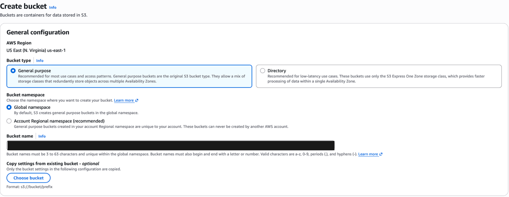

*Figure 1  General purpose bucket and unique bucket name.*

4. Scroll to Object Ownership. Select ACLs enabled, then Bucket owner preferred.

5. Keep these settings for the workshop exercise that makes one text object public.

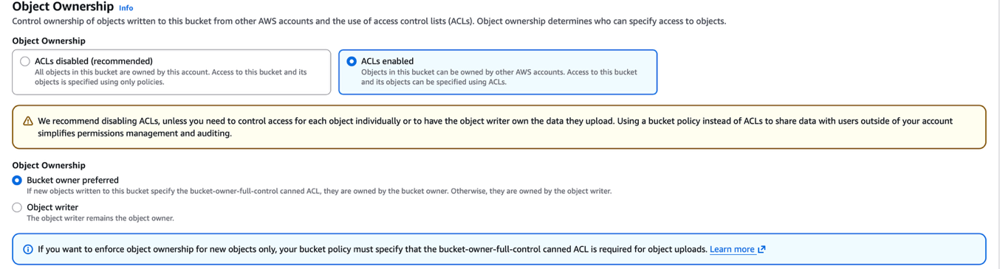

*Figure 2  ACLs enabled and Bucket owner preferred.*

Checkpoint: a unique bucket name is entered and the ownership options match the screenshots.

## 3 Configure public access and upload files

1. For the public text-file demonstration, untick Block all public access.

2. Tick the acknowledgement, leave bucket versioning disabled for this short exercise, and select Create bucket.

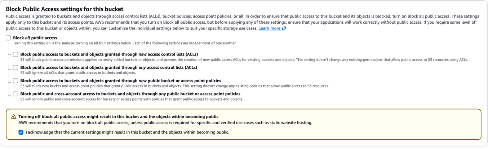

*Figure 3  Public access settings for the text-file demonstration.*

3. Open the new bucket and select Upload, then Add files.

4. Select bristol.txt, AMZN.csv and Water.csv, and select Upload.

5. Return to Objects and confirm all three files are listed.

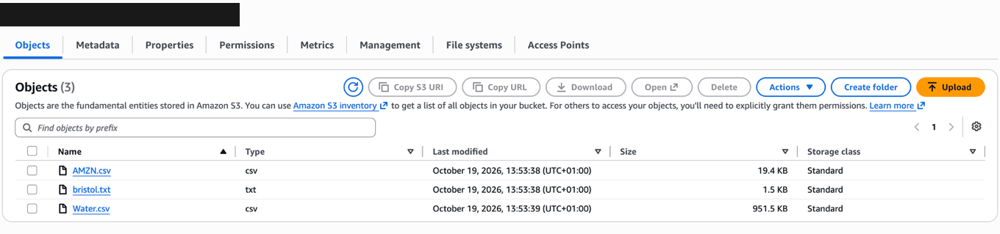

*Figure 4  The three workshop files uploaded to S3.*

Only bristol.txt needs public access for this exercise. Keep the CSV files private; EC2 will read them using its IAM role. Account-level restrictions may still block public access. If the lab prevents the public demonstration, continue with the private CLI activity and ask the tutor about the restriction.

## 4 Make the text object public

1. Open bristol.txt and copy its Object URL. Try the URL in a separate browser tab; a private object returns Access Denied.

2. Return to the Objects list, select only bristol.txt, open Actions and select Make public using ACL. Confirm the change.

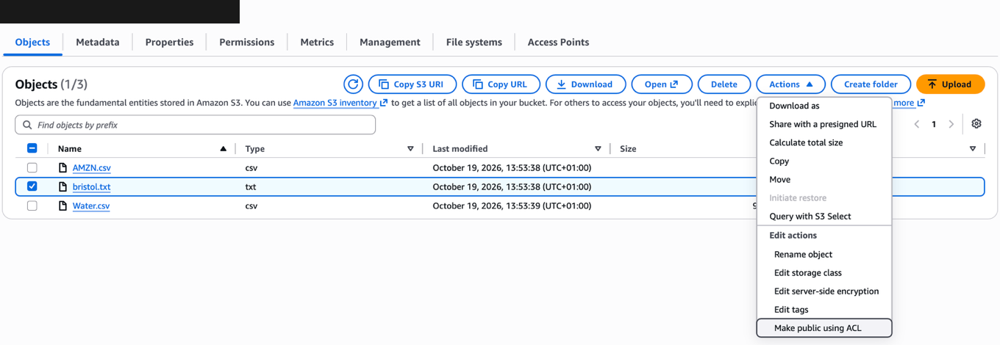

*Figure 5  Make public using ACL for the selected text file.*

3. Open bristol.txt again and locate the Object URL under Properties.

4. Refresh the URL in the other tab. The text should now display.

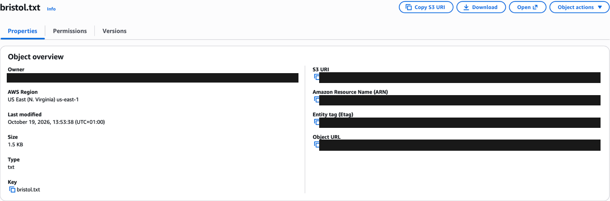

*Figure 6  Object details with identifying values removed.*

This exercise serves a public text object. It does not configure the separate S3 static website endpoint. Copy S3 URI is used later for CLI transfers; Object URL is used in the browser.

## 5 Launch an Amazon Linux instance

1. Open EC2, choose Instances and select Launch instances.

2. Enter a generic name such as LSDE-Week5-EC2.

3. Under Application and OS Images, choose Amazon Linux 2023 with 64-bit x86 architecture.

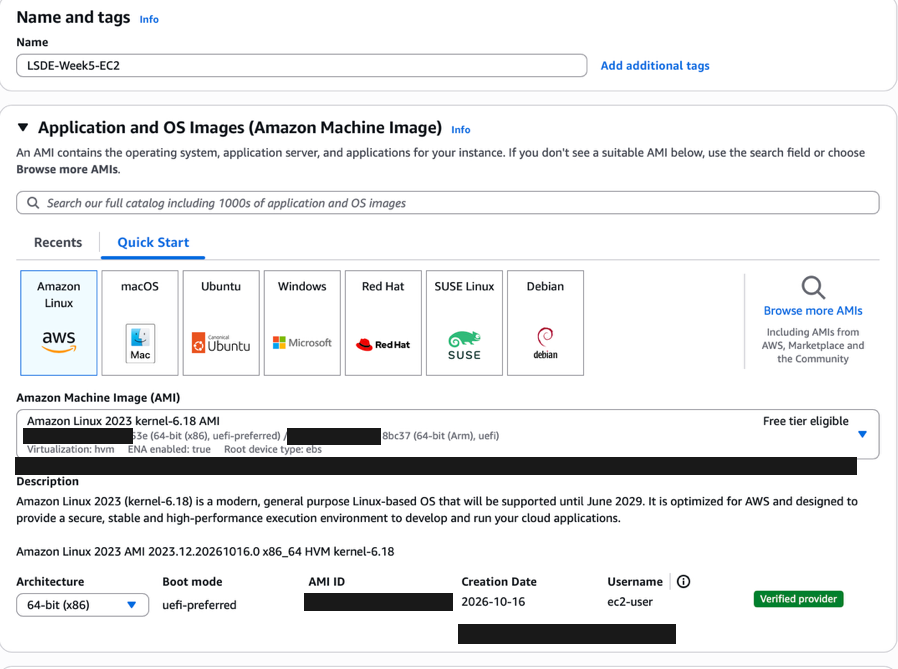

*Figure 7  Amazon Linux 2023 image selection.*

Use the operating system shown above for the dnf and mariadb105 commands in this guide. A public AMI identifier can change over time; select the current lab-supported Amazon Linux 2023 image.

## 6 Set the instance and SSH options

1. Choose t3.micro if the sandbox permits it.

2. Create a key pair, choose RSA and .pem, and save the file in Downloads. The example commands use lab-key.pem; replace this with your actual filename.

3. Choose the lab or default VPC, a public subnet and Auto-assign public IP enabled.

4. Allow SSH on TCP port 22 from My IP. Leave the default storage and select Launch instance.

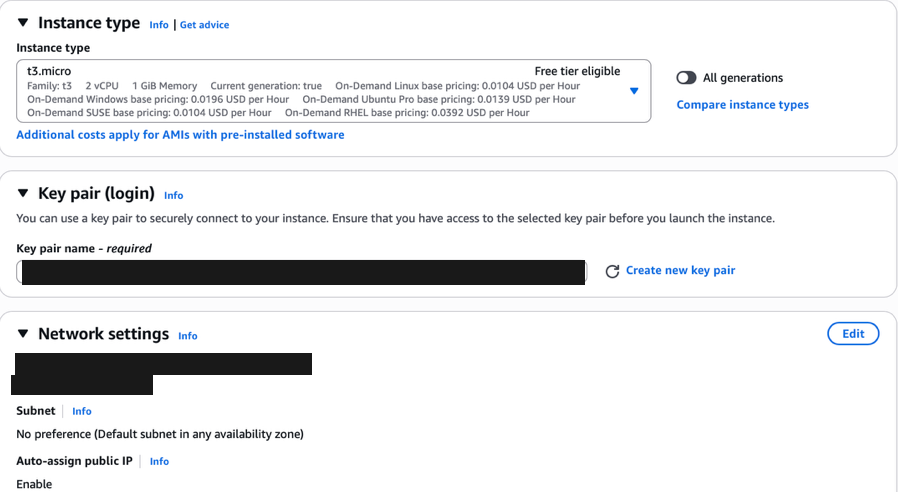

*Figure 8  Instance type key pair and network settings.*

Checkpoint: wait for the instance to be Running and its status checks to pass. Select it and find the current Public IPv4 address or Public DNS. If your public IP changes, update the SSH rule to your current My IP value.

## 7 Attach the S3 IAM role

1. Select the EC2 instance created for this practical.

2. Choose Actions, then Security, then Modify IAM role.

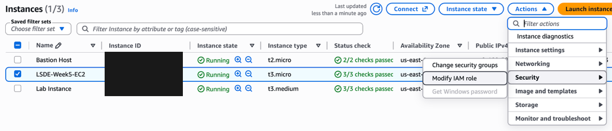

*Figure 9  The menu path to Modify IAM role.*

3. Select EMR_EC2_DefaultRole, as specified in the workshop. If it is absent, use the S3-enabled instance role provided by your sandbox.

4. Select Update IAM role.

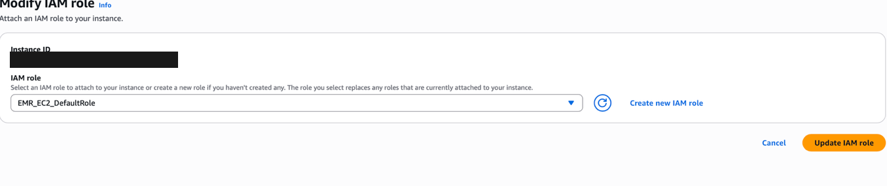

*Figure 10  The workshop IAM role selected for the instance.*

The role provides credentials to software running on EC2. If aws s3 ls reports Unable to locate credentials, check that the role is attached to this instance, allow a short time for it to appear, and retry. If it reports AccessDenied, the role may lack the required S3 permissions.

Checkpoint: the instance shows an IAM role. Select the instance you created, rather than a pre-provisioned Bastion Host or Lab Instance.

## 8 Connect to EC2 from your Mac

1. Press Command and Space, type Terminal, and press Enter.

2. Move to the folder containing your downloaded key file.

3. Restrict the key file permissions and connect using the current EC2 address.

### Run in Mac Terminal

```bash
cd ~/Downloads
chmod 400 lab-key.pem
ssh -i "lab-key.pem" ec2-user@YOUR_EC2_HOST
```

Replace both lab-key.pem occurrences with your actual downloaded filename. Replace YOUR_EC2_HOST with the current public IPv4 address or public DNS from the instance details. Type yes if asked to trust the host.

### Recognise the EC2 shell

After login, the prompt begins with ec2-user and ends with $. Commands entered here run on EC2. The .pem file remains on your Mac.

```bash
whoami
pwd
aws s3 ls
```

Expected: whoami returns ec2-user, pwd normally shows /home/ec2-user, and aws s3 ls lists the buckets your role can access.

### If the connection fails

No such file or directory: check the .pem filename and its folder. Permission denied publickey: use the key associated with this instance and the ec2-user login. Connection timed out: check the instance is running, has a public address, and permits SSH from your current public IP.

Use the SSH client command shown under EC2 Connect if you need to confirm the hostname and key filename. You can keep the AWS Console open while working in Terminal.

## 9 Copy files from S3 to EC2

Run these commands in the EC2 shell. Set BUCKET_NAME to the actual bucket created in Step 2, keeping the quotes.

```bash
BUCKET_NAME='YOUR_BUCKET_NAME'
aws s3 ls
aws s3 ls "s3://$BUCKET_NAME/"
aws s3 cp "s3://$BUCKET_NAME/bristol.txt" .
aws s3 cp "s3://$BUCKET_NAME/AMZN.csv" .
aws s3 cp "s3://$BUCKET_NAME/Water.csv" .
ls -lh
```

Keep the final dot in every download command: it means the current directory. The object key is case-sensitive. If a filename has spaces, keep its full S3 path inside quotes.

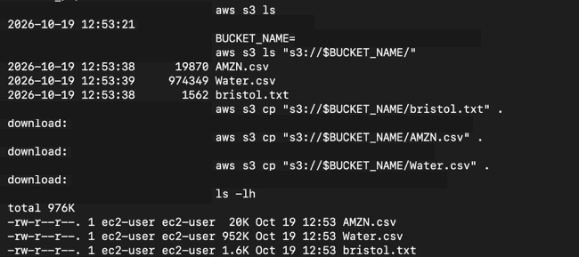

*Figure 11  CLI downloads and the three files present on EC2.*

```bash
cat bristol.txt
head -n 3 AMZN.csv
head -n 3 Water.csv
```

Checkpoint: all three files are listed locally. The CSV headers should match the positional import mappings later in this guide, with dates in YYYY-MM-DD format.

## 10 Copy an EC2 file back to S3

Create a copy of the downloaded text file and upload that copy to the same bucket.

```bash
cp bristol.txt bristol_copy.txt
aws s3 cp bristol_copy.txt "s3://$BUCKET_NAME/"
aws s3 ls "s3://$BUCKET_NAME/"
```

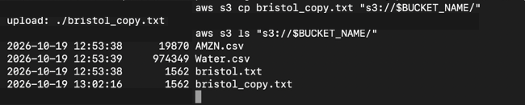

*Figure 12  The uploaded text copy appears in the S3 listing.*

1. Refresh the S3 Objects list in the AWS Console.

2. Confirm bristol_copy.txt is present alongside the original three files.

### What the two copies mean

cp creates a local copy inside EC2. aws s3 cp uploads or downloads between EC2 and S3. The contents of the original text file are unchanged by creating and uploading the copy.

### Workshop challenge

The command below removes all current objects from the named bucket. Save it for the end of the practical, after both CSV imports and after you have recorded your results.

```bash
aws s3 rm "s3://$BUCKET_NAME/" --recursive
```

For a versioned bucket, this command does not remove every historical version. Use the console Empty action when a complete bucket cleanup is needed.

## 11 Create the RDS MySQL instance

Keep the EC2 Terminal session open. In the AWS Console, open Aurora and RDS, choose Databases and select Create database.

| Setting | Choose |
| --- | --- |
| Creation method | Standard create |
| Engine | MySQL |
| Engine version | A version supported by the sandbox |
| Template | Free tier if shown otherwise Dev/Test |
| Availability | Single-AZ DB instance |
| DB identifier | lsde-week5-db or another generic lab name |
| Credentials | Self managed with master username admin |
| Master password | Create your own and keep it private |
| Instance class | Burstable classes then db.t3.micro if permitted |
| Storage | General Purpose SSD with 20 GiB if supported |
| Compute resource | Connect to an EC2 compute resource |
| EC2 selection | The instance created for this practical |
| VPC | The same VPC as EC2 |
| Public access | No |
| Port | 3306 |
| Authentication | Password authentication |
| Enhanced monitoring | Off for this short lab |
| Encryption | Leave enabled |
| Initial database name | Leave blank; create it with SQL later |

Select Create database. Wait for Available. The EC2 connection option sets up the connection security groups. If you configure them manually, allow TCP 3306 on the RDS security group from the EC2 security group.

Use the Academy sandbox and its allowed instance types and budget.

## 12 Find the endpoint and prepare the client

1. Open the new RDS instance and confirm its status is Available.

2. Choose Connectivity and security. Use Endpoints or the connection snippet to locate the instance endpoint.

3. Copy only the hostname, without https:// or :3306. Keep the database private and use EC2 for the client connection.

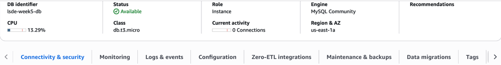

*Figure 13  RDS available with MySQL and a micro instance class.*

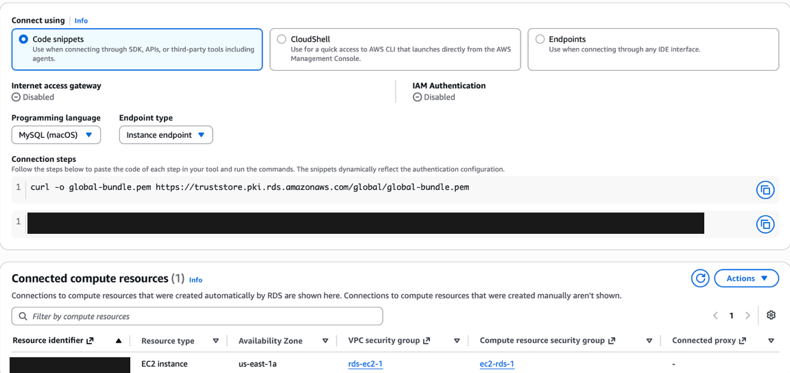

*Figure 14  Endpoint connection area and linked EC2 resource.*

### Run in the EC2 shell

```bash
sudo dnf update -y
sudo dnf install mariadb105 -y
mysql --version
cd /home/ec2-user
ls -lh AMZN.csv Water.csv
```

mariadb105 supplies the MySQL-compatible client on Amazon Linux 2023. If either CSV is missing, repeat the relevant S3 download from Step 9.

## 13 Connect EC2 to RDS

Run the following in the EC2 shell. Replace YOUR_RDS_ENDPOINT with the endpoint copied from your current RDS instance.

```bash
cd /home/ec2-user
curl -o global-bundle.pem \
  https://truststore.pki.rds.amazonaws.com/global/global-bundle.pem
RDS_ENDPOINT='YOUR_RDS_ENDPOINT'
mysql --local-infile=1 -h "$RDS_ENDPOINT" -P 3306 \
  -u admin -p \
  --ssl-ca=/home/ec2-user/global-bundle.pem \
  --ssl-verify-server-cert
```

Enter the RDS master password when prompted. It is normal for no characters to appear while typing. The certificate flags above are for the MariaDB client installed in Step 12.

### Run at the MySQL prompt

```sql
SELECT CURRENT_TIMESTAMP;
SHOW GLOBAL VARIABLES LIKE 'local_infile';
```

The timestamp confirms a working connection. local_infile should be ON before you import CSV files. If it is OFF, follow Appendix A. The client option --local-infile=1 and the server setting must both allow local imports.

### Confirm the data before importing

```sql
\! head -n 3 /home/ec2-user/AMZN.csv
\! head -n 3 /home/ec2-user/Water.csv
```

The backslash exclamation command runs a shell command from the MySQL client. Do not add a SQL semicolon to these two commands. The files are local to EC2 because that is where the client runs.

These steps connect the MySQL client running on EC2 directly to RDS. Appendix B shows the separate optional SSH-tunnel route for a client running on your Mac.

## 14 Create and import the finance table

```sql
CREATE DATABASE IF NOT EXISTS finance_db;
USE finance_db;
CREATE TABLE IF NOT EXISTS amazon_prices (
    `date` DATE PRIMARY KEY,
    `open` DECIMAL(12,4) NOT NULL,
    `high` DECIMAL(12,4) NOT NULL,
    `low` DECIMAL(12,4) NOT NULL,
    `close` DECIMAL(12,4) NOT NULL,
    adj DECIMAL(12,4) NOT NULL,
    volume BIGINT UNSIGNED NOT NULL
);
DESCRIBE amazon_prices;
SELECT COUNT(*) AS existing_rows FROM amazon_prices;
```

If the table already contains a completed import, inspect it and skip the LOAD DATA command. IF NOT EXISTS preserves an existing table; it does not check or repair its structure.

### Import into an empty table

```sql
LOAD DATA LOCAL INFILE '/home/ec2-user/AMZN.csv'
INTO TABLE amazon_prices
FIELDS TERMINATED BY ','
OPTIONALLY ENCLOSED BY '"'
LINES TERMINATED BY '\n'
IGNORE 1 LINES
(`date`, `open`, `high`, `low`, `close`, adj, volume);
SHOW WARNINGS LIMIT 10;
SELECT COUNT(*) AS amazon_rows FROM amazon_prices;
SELECT * FROM amazon_prices ORDER BY `date` LIMIT 10;
```

The CSV order is date, open, high, low, close, adj_close, volume. The sixth input column maps to adj. IGNORE 1 LINES skips the header. Prices are stored to four decimal places; volume uses BIGINT for large whole-number counts.

Checkpoint: the supplied AMZN.csv produced 251 rows in the recorded run. Review warnings immediately after LOAD DATA; later statements can replace the warning list.

## 15 Query finance data and create the Water table

### Query and update the finance record

```sql
USE finance_db;
SELECT * FROM amazon_prices
WHERE `date` = '2021-10-15';

UPDATE amazon_prices
SET `open` = 1000.00, `close` = 1100.00
WHERE `date` = '2021-10-15';

SELECT * FROM amazon_prices
WHERE `date` = '2021-10-15';
```

The update changes one example record. Check that the query finds the date first, and keep the WHERE clause so that other dates are not updated. If the original values were already changed in a previous run, MySQL can report zero changed rows.

### Create the Water database and table

```sql
CREATE DATABASE IF NOT EXISTS water_db;
USE water_db;
CREATE TABLE IF NOT EXISTS water_data (
    `date` DATE PRIMARY KEY,
    precipitation DECIMAL(12,4) NOT NULL,
    pet DECIMAL(12,4) NOT NULL,
    temperature DECIMAL(12,4) NOT NULL,
    disch_spec DECIMAL(12,4) NULL,
    disch_vol DECIMAL(12,4) NULL,
    peti DECIMAL(12,4) NOT NULL,
    humidity DECIMAL(12,4) NOT NULL,
    short_rad DECIMAL(12,4) NOT NULL,
    long_rad DECIMAL(12,4) NOT NULL,
    windspeed DECIMAL(12,4) NOT NULL
);
DESCRIBE water_data;
SELECT COUNT(*) AS existing_rows FROM water_data;
```

The two discharge fields allow NULL because the CSV contains missing discharge values. If this table already contains the completed import, skip its LOAD DATA command.

## 16 Import and inspect the Water data

Run the following only when water_data is empty and its structure matches Step 15.

```sql
USE water_db;
LOAD DATA LOCAL INFILE '/home/ec2-user/Water.csv'
INTO TABLE water_data
FIELDS TERMINATED BY ','
OPTIONALLY ENCLOSED BY '"'
LINES TERMINATED BY '\n'
IGNORE 1 LINES
(
    `date`, precipitation, pet, temperature,
    @disch_spec, @disch_vol, peti, humidity,
    short_rad, long_rad, windspeed
)
SET
    disch_spec = NULLIF(@disch_spec, ''),
    disch_vol = NULLIF(@disch_vol, '');

SHOW WARNINGS LIMIT 10;
SELECT COUNT(*) AS water_rows FROM water_data;
SELECT * FROM water_data ORDER BY `date` LIMIT 10;
```

### How the input columns map

The CSV header uses discharge_spec and discharge_vol; these input positions are mapped to the SQL columns disch_spec and disch_vol. Likewise, shortwave_rad and longwave_rad map to short_rad and long_rad. Mapping is positional, so keep the order shown above.

The @ variables temporarily hold the raw discharge fields. NULLIF converts empty strings into SQL NULL. Missing measurements stay missing instead of becoming zero.

### Expected checks

The supplied Water.csv produced 16,436 rows in the recorded run. The first dates begin in October 1970, and some discharge fields are NULL. If the import reports invalid dates, incorrect numeric values or skipped rows, inspect the warnings before continuing.

If the file has different columns, date formatting, or missing-value markers, adjust the import to the file rather than forcing it into this mapping.

## 17 Query and update the Water data

```sql
USE water_db;
SELECT * FROM water_data
WHERE `date` = '1970-10-01';

UPDATE water_data
SET disch_spec = 10.00, disch_vol = -10.00
WHERE `date` = '1970-10-01';

SELECT * FROM water_data
WHERE `date` = '1970-10-01';
```

These are artificial values from the workshop exercise. The negative discharge value demonstrates an UPDATE; it is not a validated environmental measurement.

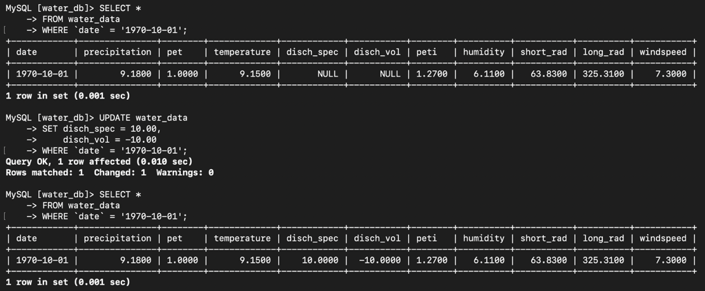

*Figure 15  The selected Water record before and after the example update.*

Expected values are 10.0000 for disch_spec and -10.0000 for disch_vol on 1970-10-01. The recorded update matched and changed one row, with zero update warnings.

## 18 Verify the completed practical

```sql
SELECT COUNT(*) AS amazon_rows
FROM finance_db.amazon_prices;
SELECT COUNT(*) AS water_rows
FROM water_db.water_data;
```

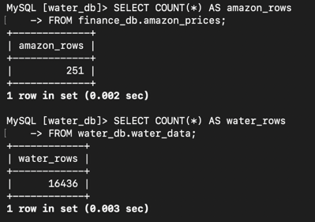

*Figure 16  Recorded counts for both imported datasets.*

| Table | Recorded rows |
| --- | --- |
| finance_db.amazon_prices | 251 |
| water_db.water_data | 16,436 |

Save the row counts and the before-and-after queries as evidence of the exercise. Row counts confirm that records are present; review import warnings and sample values as well.

### Exit each session

At the MySQL prompt, leave the database client:

```sql
EXIT;
```

At the EC2 shell prompt, disconnect SSH:

```bash
exit
```

Exiting Terminal does not delete the AWS resources. Clean them up in Step 19 when you have finished practising.

## 19 Clean up your lab resources

Complete this step after saving your results and when you no longer need this disposable setup. Delete only the resources you created for this practical.

### Delete the RDS database

1. Open RDS, then Databases, and select the workshop DB instance.

2. Choose Actions, then Delete. If deletion protection blocks the action, use Modify to disable it for this disposable lab database.

3. For this temporary exercise, clear Create final snapshot and Retain automated backups if you do not need a saved copy. Complete the acknowledgement and confirm deletion.

### Terminate the EC2 instance

1. Open EC2, select your workshop instance and choose Instance state.

2. Select Terminate instance and confirm. Do not terminate pre-provisioned sandbox resources such as a lab instance or bastion host.

### Empty and delete the S3 bucket

1. Open S3 and select your workshop bucket.

2. Choose Empty and complete the confirmation. This removes the stored objects.

3. Return to the bucket list, select the empty bucket and choose Delete. Complete the confirmation.

The workshop CLI challenge can remove the current objects before you disconnect from EC2:

```bash
aws s3 rm "s3://$BUCKET_NAME/" --recursive
```

Use the console Empty action for a versioned bucket. Do not run either action until you have finished using the CSV files.

### End the Academy session

Return to AWS Academy and select End Lab according to your sandbox instructions. Check the console for leftover resources you created, such as manually retained snapshots or unattached storage. EC2 and RDS are separate resources and need separate cleanup.

## Appendix A Enable local CSV imports

Use these steps only if SHOW GLOBAL VARIABLES LIKE local_infile reports OFF. The default parameter group cannot be edited directly.

1. In RDS, open your database Configuration tab and note the MySQL engine version and current DB parameter group.

2. Open Parameter groups and select Create parameter group. Choose the family matching your engine version, for example mysql8.4 for MySQL 8.4.

3. Choose DB Parameter Group if a type is requested. Enter a generic name such as lsde-local-infile and create it.

4. Open the new group, choose Edit parameters, search for local_infile and set its value to 1. Save changes.

5. Open your database and choose Modify. Under Additional configuration, select the new DB parameter group.

6. Choose Continue, then Apply immediately, and confirm the modification.

7. If the database or parameter group shows Pending reboot, choose Actions and Reboot. Wait for Available.

8. Exit the old MySQL client and reconnect using the command in Step 13, including --local-infile=1.

### Check again at the MySQL prompt

```sql
SHOW GLOBAL VARIABLES LIKE 'local_infile';
```

Expected value: ON. If the Academy sandbox does not permit creating or attaching parameter groups, ask the tutor to enable local imports using the lab-supported method.

### Do not repeat completed imports

If an import has already completed, check its table count before running LOAD DATA again. The date primary key prevents duplicate dates, but repeated imports can create warnings and obscure the original result.

## Appendix B SSH tunnel and troubleshooting

### Optional SSH tunnel for a client on your Mac

The main guide runs the MySQL client on EC2 and does not need port forwarding. If your tutor asks you to demonstrate a tunnel from your Mac, run the following in Mac Terminal after replacing the key, endpoint and EC2 hostname:

```bash
ssh -i "lab-key.pem" \
  -L 127.0.0.1:13306:YOUR_RDS_ENDPOINT:3306 \
  ec2-user@YOUR_EC2_HOST
```

Keep this SSH session open. In a local database client, the forwarded host is 127.0.0.1 and the port is 13306. This tunnel does not install a local client or automatically configure TLS certificate hostname verification. For the CSV imports in this guide, continue using the client on EC2.

### Common problems

| Symptom | Action |
| --- | --- |
| Unable to locate credentials | Attach the course S3-enabled IAM role to the EC2 instance. |
| S3 AccessDenied | Check the role permissions, bucket name and exact object key. |
| MySQL command not found | On Amazon Linux 2023, install mariadb105 with dnf. |
| RDS connection times out | Check Available status, the endpoint, the same VPC, and TCP 3306 from the EC2 security group. |
| Access denied for admin | Check the master username and password. Reset through RDS Modify if necessary. |
| Local loading is disabled | Enable both the client option and the server setting; see Appendix A. |
| File not found | Check /home/ec2-user, filename spelling and case. Download again from S3 if missing. |
| Unknown ssl-mode option | Use the MariaDB certificate options from Step 13. |
| Invalid values or duplicate keys | Read SHOW WARNINGS immediately. Check the CSV mapping and whether data was already imported. |

### Reference material

LSDE Workshop Week 5 slides and the supplied workshop screenshots. AWS documentation: Creating and connecting to a MySQL DB instance; Importing data from any source to RDS for MySQL; Granting public access to S3 data. MariaDB documentation: Securing connections for client and server.

AWS and MariaDB documentation are available at docs.aws.amazon.com and mariadb.com/docs. Console labels can vary; use the matching setting in your sandbox.


## Use the supplied SQL and helper scripts

The numbered walkthrough above works by copying commands directly. The files in
`sql/` and `scripts/` are optional reusable versions. To use them, first clone or copy
this repository to EC2. After uploading it to your GitHub account, an example is:

```bash
# Run in the EC2 shell; replace the GitHub username and repository name.
sudo dnf install git -y
git clone https://github.com/YOUR_GITHUB_USERNAME/LSDE-Week5-AWS-S3-EC2-RDS.git /home/ec2-user/week5
cd /home/ec2-user/week5
```

For a private repository, copy the folder using your existing SSH workflow or use
your configured GitHub authentication. A public repository can be cloned using the
URL above.

Download files from S3 after attaching the IAM role, then connect to RDS:

```bash
# Run in the EC2 shell from the repository root.
bash scripts/download_from_s3.sh YOUR_BUCKET_NAME
sudo dnf install mariadb105 -y
bash scripts/connect_rds.sh YOUR_RDS_ENDPOINT admin
```

The download helper writes to `/home/ec2-user` by default, matching the SQL file
paths. The connection helper downloads the AWS CA bundle and prompts for your
password. It uses the MariaDB client options from the walkthrough.

At the **MySQL prompt**, execute one file at a time:

```sql
SOURCE /home/ec2-user/week5/sql/01_create_finance.sql;
```

Confirm `existing_rows` is **0** before importing. Then:

```sql
SOURCE /home/ec2-user/week5/sql/02_import_finance.sql;
SOURCE /home/ec2-user/week5/sql/03_create_water.sql;
```

Confirm the Water `existing_rows` result is **0** before continuing:

```sql
SOURCE /home/ec2-user/week5/sql/04_import_water.sql;
SOURCE /home/ec2-user/week5/sql/05_verify.sql;
```

Stop and inspect any import warnings or unexpected counts. `SOURCE` is entered at
the database prompt, not at the EC2 shell. If you copied the repository to a different
directory, adjust the paths. If a table already has the completed import, skip its
import file; the scripts do not automatically erase or reload existing tables.

The walkthrough's UPDATE examples keep their changes. For a reversible practice
version, use:

```sql
SOURCE /home/ec2-user/week5/sql/06_demo_updates.sql;
```

This optional file shows the before-and-after values in a transaction, then runs
`ROLLBACK`. To retain the artificial example edits, deliberately replace its final
`ROLLBACK` with `COMMIT` before running it.

## Validation and privacy

Run the data checks locally on your Mac or on EC2 from the repository root:

```bash
python3 scripts/check_data.py
```

Expected output:

```text
PASS AMZN.csv: 251 rows, 2020-11-09 to 2021-11-05
PASS Water.csv: 16,436 rows, 1970-10-01 to 2015-09-30
Headers, numeric fields, missing values and unique sorted dates checked.
```

Python 3 is only needed for this optional offline check. The main AWS practical
uses the AWS CLI and the MariaDB MySQL client on EC2. See
[validation details](docs/VALIDATION.md) and [data mappings](data/README.md).

The screenshots, illustrated documents and source slide copy have identifying
cloud values removed. The package excludes the original unredacted screenshot
document, private keys, credentials and local session history. The included
`.gitignore` helps prevent common credential files from being committed later;
keep any new screenshots or local connection settings private until you redact them.

